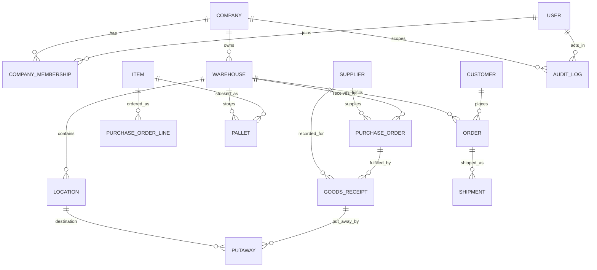

# WareFlow Architecture (Current Implementation)

## Application shape

WareFlow is a modular monolith. The canonical web client is React 19 with Vite in `frontend/`; the API is Express 4 with Mongoose 6 in `backend/`. `backend/server.js` loads backend environment variables, configures CORS and JSON parsing, mounts authentication/company/platform/operational routes, and connects to MongoDB on startup. A legacy duplicate client exists in `backend/frontend/`; it is not the frontend build target used by the project scripts or this report.

## Authentication and authorization

The frontend sends a JWT bearer token through `frontend/src/api.js`; the token is currently stored in browser localStorage. Backend `auth` verifies the token and reloads the account. Tenant middleware derives company membership and warehouse assignment from the authenticated user and active membership; request company IDs are not trusted as authority. Central permission middleware maps roles and routes to permissions and rejects Super Admin from ordinary operational APIs. Stored `superadmin` is normalized at the authorization boundary alongside canonical `super_admin`.

The seven application roles are `super_admin`, `company_admin`, `warehouse_manager`, `inventory_manager`, `procurement_manager`, `warehouse_staff`, and `auditor`. Effective allow/deny overrides are membership-scoped; explicit deny is evaluated before role grants. Company membership changes use revision checks, transactions, audit writes, active-actor revalidation, and last-admin protection.

## Main modules and data relationships

The diagram reflects references found in current Mongoose schemas; it is intentionally not a complete attribute-level ERD.

Company-owned documents use `companyId`; older records may retain `companyId: null` and `ownerId`. Tenant middleware and the ownership plugin scope supported Mongoose operations; direct aggregation and raw collection operations require explicit scrutiny. Warehouse-scoped models carry `warehouseId` or a schema-declared warehouse field. Warehouse Managers and Staff are checked against their assigned warehouse IDs.

## Inventory lifecycle

`Pallet` holds stock quantities and an embedded `movementLog`. `InventoryOperation` stores idempotency/replay information for important stock changes. `inventoryService` performs stock-in, adjustments, and batch deduction; procurement and outbound services use MongoDB sessions for multi-document changes. GRN receipt creates received/quarantined quantities, inspection classifies goods, and putaway moves accepted goods into a location. Reservation and picking move quantities between available/reserved/picked states; dispatch is the modern outbound physical stock deduction. Shipment delivery confirmation changes delivery state without another stock deduction.

## Procurement and order fulfillment

`PurchaseOrder` references supplier, destination warehouse, and product line IDs. `GoodsReceipt` references its PO, supplier, warehouse and receipt pallets; `Putaway` references the GRN line, source/destination pallets, and location. PO creation itself does not add inventory.

Customer orders use `Order` and `Customer`. `outboundService` implements order create/update/submit, reservation, picker assignment, picking, packing, dispatch, delivery, and cancellation/release. `Shipment` records dispatch/delivery details. These transactions require a replica-set or sharded MongoDB topology.

## Reporting and administration

`report.routes.js` returns company/warehouse-scoped inventory and movement summaries. `movementReport.js` treats GRN receipt and valid manual stock-in as received, excludes receipt-linked putaway stock-in to prevent double counting, and counts dispatch as shipped; reservation and picking are not shipped quantities. Quality totals are sourced from GRN lines.

The `/api/admin` route family is mounted behind authentication and Super Admin authorization. User summaries resolve active memberships and active companies and aggregate by company ID, retaining only the selected user's unmigrated owner-scoped rows as legacy data. Platform monitoring is separate from ordinary operational APIs.

## Transactions, idempotency, and operations

Important inventory, procurement, outbound, membership, and activation paths use Mongoose sessions. Idempotency records are written with the corresponding business changes where implemented. Declared unique indexes support scoped references and replay protection; a separate read-only script audits current indexes and duplicate tuples. Its existence does not mean indexes have been applied in any particular database.

The migration write-freeze uses a shared MongoDB control record and application write leases. It coordinates application instances that use the middleware; it cannot prevent direct database clients or unrelated external writers. Company migration scripts are not part of startup and were not run during this readiness check.

